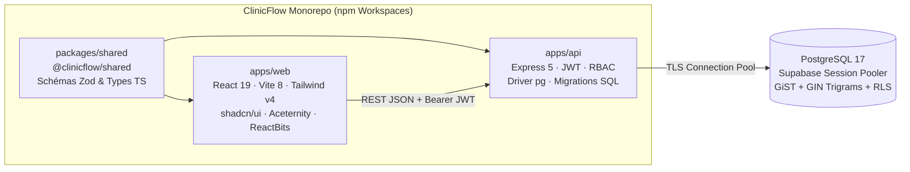

<div align="center">

# ClinicFlow — Plateforme Clinique de Gestion des Patients & Rendez-vous

**Solution Full-Stack PERN (PostgreSQL 17 · Express 5 · React 19 · Node.js 22) en TypeScript strict**  
*Conçue avec contrats Zod partagés, garantie anti-chevauchement atomique PostgreSQL GiST et interface hybride Mobile/Desktop.*

[](https://github.com/ELHATIMY-HAMZA/Clinic-Flow-Project/actions/workflows/ci.yml)


[**Architecture Système**](docs/ARCHITECTURE.md) · [**Modèle de Données (ERD)**](docs/ERD.md) · [**Décisions d'Architecture (ADRs)**](docs/adr/) · [**Glossaire Métier**](GLOSSARY.md) · [**Guide de Contribution**](CONTRIBUTING.md)

</div>

---

## 1. Vision Produit & Valeur Ajoutée

**ClinicFlow** est une application web moderne destinée aux cliniques et cabinets médicaux souhaitant fiabiliser leur accueil patient et éliminer les erreurs de planification :

- **Zéro double-réservation garantie mathématiquement** : un patient ne peut jamais avoir deux rendez-vous `confirmed` dans une fenêtre de **30 minutes**, protégé à la fois par le service Express et par une contrainte atomique PostgreSQL `EXCLUDE USING gist` (résistante aux conditions de course concurrentes).
- **Recherche clinique instantanée** : recherche par nom complet ou numéro de **CIN** propulsée par des index trigrammes PostgreSQL `GIN (pg_trgm)`.
- **Contrôle d’accès basé sur les rôles (RBAC)** : séparation stricte entre `admin` (accès complet, suppression de dossiers) et `receptionist` (accueil, création/modification de patients et gestion du planning).
- **Interface Hybride Desktop & Mobile** :
  - **Poste Secrétariat (`1024px` – `1440px+`)** : Barre latérale architecturale fixe, barre de contexte supérieure, BentoGrid analytique et tableaux haute densité.
  - **Mobile & Tablette en Clinique (`390px` – `768px`)** : Barre de navigation inférieure fixe (`safe-area`), cartes cliniques tactiles (`>= 44px`), zéro défilement horizontal.

---

## 2. Architecture du Monorepo



| Répertoire | Rôle | Documentation |
|---|---|---|
| `packages/shared/` | Schémas **Zod** et types TypeScript partagés entre l’API et le client React | [ADR-0001](docs/adr/0001-monorepo-shared-zod-contracts.md) |
| `apps/api/` | API REST Express 5, middlewares JWT/RBAC, migrations SQL (`001`–`005`) et seed | [Architecture](docs/ARCHITECTURE.md) |
| `apps/web/` | SPA React 19, TanStack Query v5, Design System clinique responsive | [ADR-0004](docs/adr/0004-hybrid-responsive-design-system.md) |
| `docs/` | Architecture C4/Mermaid, diagramme ERD et Architecture Decision Records | [ERD.md](docs/ERD.md) |
| `.github/` | Pipeline CI GitHub Actions (Postgres 17), templates de PR et d’Issues | [ci.yml](.github/workflows/ci.yml) |

---

## 3. Démarrage Rapide (Quick Start)

### Option A — Développement Local (avec Supabase PostgreSQL ou PostgreSQL local)

1. **Installer les dépendances du monorepo** :
   ```bash
   npm install
   ```
2. **Configurer les variables d’environnement** :
   ```bash
   cp .env.example .env
   # Renseignez votre DATABASE_URL (Supabase Session Pooler port 5432 avec DATABASE_SSL=true, ou Postgres local)
   ```
3. **Appliquer les migrations SQL et insérer les données de démonstration** :
   ```bash
   npm run db:migrate
   npm run db:seed
   ```
4. **Lancer le serveur de développement (API `:4000` + Web `:5173`)** :
   ```bash
   npm run dev
   ```
   Ouvrez **http://localhost:5173** dans votre navigateur.

### Option B — Déploiement Conteneurisé Complet (Docker Compose)

Lance PostgreSQL 17, exécute automatiquement les migrations et le seed, démarre l’API Express et sert le frontend via Nginx :

```bash
docker compose up --build
```
- **Application Web (Nginx + Proxy `/api`)** : http://localhost:8080  
- **API Healthcheck direct** : http://localhost:4000/api/health  

---

## 4. Comptes de Démonstration (Créés par `npm run db:seed`)

| Rôle | E-mail | Mot de passe | Permissions |
|---|---|---|---|
| **Administrateur (`admin`)** | `admin@clinicflow.ma` | `Admin123!` | Accès total, création/édition/suppression de patients, gestion des rendez-vous |
| **Réceptionniste (`receptionist`)** | `reception@clinicflow.ma` | `Reception123!` | Accès complet sauf suppression de dossiers patients (`DELETE /api/patients/:id` → `403`) |
| **Réceptionniste 2 (`receptionist`)** | `sara.benali@clinicflow.ma` | `Reception123!` | Accès complet sauf suppression de dossiers patients |

---

## 5. Référence des Endpoints REST API

Toutes les routes (hors `/api/health` et `/api/auth/login`) exigent l’en-tête `Authorization: Bearer <token>`.

| Méthode | Endpoint | Rôles | Description |
|---|---|---|---|
| `GET` | `/api/health` | Public | État de santé de l’API et latence PostgreSQL |
| `POST` | `/api/auth/login` | Public | Authentification par e-mail/mot de passe → retourne `{ token, user }` |
| `GET` | `/api/auth/me` | Authentifié | Profil de l’utilisateur connecté |
| `GET` | `/api/dashboard/stats` | Authentifié | Compteurs temps réel (`totalPatients`, `todayAppointments`, `pendingAppointments`, `confirmedAppointments`) |
| `GET` | `/api/patients?page=&limit=&search=` | Authentifié | Liste paginée avec recherche instantanée par `full_name` ou `cin` |
| `POST` | `/api/patients` | Authentifié | Création d’un dossier patient (`cin` unique) |
| `GET` | `/api/patients/:id` | Authentifié | Détail complet d’un dossier patient |
| `PUT` | `/api/patients/:id` | Authentifié | Mise à jour d’un dossier patient |
| `DELETE` | `/api/patients/:id` | **`admin` uniquement** | Suppression d’un patient et de ses rendez-vous (`CASCADE`) |
| `GET` | `/api/patients/:id/appointments` | Authentifié | Historique complet des rendez-vous d’un patient |
| `GET` | `/api/appointments?date=YYYY-MM-DD&status=` | Authentifié | Liste paginée des rendez-vous filtrable par date et statut |
| `POST` | `/api/appointments` | Authentifié | Création d’un rendez-vous (vérifie la fenêtre de 30 min si `confirmed`) |
| `PATCH` | `/api/appointments/:id/status` | Authentifié | Transition de statut (`pending` / `confirmed` / `cancelled`) avec contrôle de conflit 30 min |

---

## 6. Décisions d’Architecture Documentées (ADRs)

Les choix techniques structurants sont documentés dans [`docs/adr/`](docs/adr/) :

- [**ADR-0001**](docs/adr/0001-monorepo-shared-zod-contracts.md) — Monorepo TypeScript avec Contrats Zod Partagés (`@clinicflow/shared`)
- [**ADR-0002**](docs/adr/0002-supabase-postgres-session-pooler-and-rls-lockdown.md) — Hébergement PostgreSQL sur Supabase (Session Pooler) et Verrouillage RLS
- [**ADR-0003**](docs/adr/0003-30min-appointment-conflict-gist-exclusion.md) — Garantie Anti-Chevauchement de 30 Minutes par Contrainte d’Exclusion GiST
- [**ADR-0004**](docs/adr/0004-hybrid-responsive-design-system.md) — Système de Design Hybride Mobile/Desktop & Architecture UI

---

## 7. Commandes de Qualité & Vérification

```bash
npm run typecheck   # Vérification TypeScript stricte (shared + api + web)
npm run lint        # Analyse statique ESLint
npm run build       # Build de production des 3 packages
```
