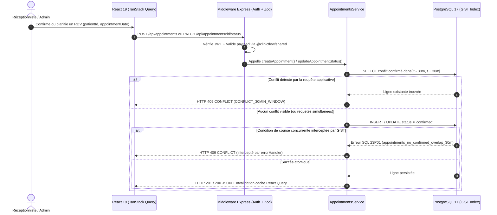

# Architecture Technique & Conception Système — ClinicFlow

Ce document présente l’architecture complète de **ClinicFlow**, conçue pour répondre aux standards d’une **startup HealthTech / SaaS B2B** : séparation stricte des responsabilités, typage de bout en bout, garanties transactionnelles au niveau base de données, et expérience utilisateur hybride Desktop/Mobile.

---

## 1. Vue d’Ensemble de l’Architecture (Modèle C4 — Conteneurs)

```mermaid
flowchart TB
  subgraph Clients["Postes Cliniques & Appareils Mobiles"]
    Web["Application Web React 19 (SPA)\nVite 8 · Tailwind CSS v4 · TanStack Query v5\nDesktop (Sidebar + Tables) & Mobile (Bottom Nav + Cards)"]
  end

  subgraph Edge["Conteneur / Réseau Applicatif"]
    Nginx["Nginx Reverse Proxy (Production Docker)\nCompression Gzip · Cache Assets · Proxy /api"]
    API["API RESTful Express 5 (Node.js 22 + TypeScript)\nValidation Zod · Auth JWT · RBAC · Helmet · Rate Limit"]
  end

  subgraph Shared["Contrat Partagé (Monorepo Workspace)"]
    ZodPkg["@clinicflow/shared\nSchémas Zod & DTOs TypeScript"]
  end

  subgraph DataLayer["Infrastructure Base de Données (Supabase / PostgreSQL 17)"]
    Pooler["Supabase Session Pooler (IPv4/IPv6 · TLS)\nPort 5432"]
    PG[("PostgreSQL 17\nExtensions: btree_gist, pg_trgm\nRLS activé (Lockdown PostgREST)")]
  end

  Web -->|HTTPS / JSON + Bearer JWT| Nginx
  Nginx -->|Proxy /api/*| API
  Web -.->|Import statique| ZodPkg
  API -.->|Validation runtime| ZodPkg
  API -->|Pool pg (TLS)| Pooler
  Pooler --> PG
```

---

## 2. Organisation du Monorepo (npm Workspaces)

```text
clinicflow/
├── .github/
│   ├── workflows/ci.yml                 # Pipeline CI/CD (Typecheck, Lint, Build, Test E2E Postgres)
│   ├── PULL_REQUEST_TEMPLATE.md         # Standard de revue de code
│   └── ISSUE_TEMPLATE/                  # Templates de tickets (Bug / Feature)
├── docs/
│   ├── ARCHITECTURE.md                  # Ce document d'architecture système
│   ├── ERD.md                           # Modèle Conceptuel & Physique de Données (Mermaid ERD)
│   └── adr/                             # Architecture Decision Records (ADRs 0001 à 0004)
├── packages/
│   └── shared/                          # @clinicflow/shared — Schémas Zod & contrats TypeScript
├── apps/
│   ├── api/                             # Backend Express 5 + PostgreSQL (driver natif pg)
│   │   ├── db/
│   │   │   ├── migrations/              # Migrations SQL idempotentes (001 à 005)
│   │   │   ├── migrate.ts               # Exécuteur transactionnel de migrations
│   │   │   └── seed.ts                  # Jeu de données clinique réaliste
│   │   └── src/
│   │       ├── config/                  # Validation env (Zod) + Pool PostgreSQL résilient
│   │       ├── middlewares/             # authenticate, requireRole, validate, errorHandler
│   │       └── modules/                 # Modules métier : auth, patients, appointments, dashboard
│   └── web/                             # Frontend React 19 + Vite 8 + Tailwind v4
│       └── src/
│           ├── api/                     # Client Axios + Hooks TanStack Query (cache & invalidation)
│           ├── auth/                    # AuthContext, ProtectedRoute, RoleGate
│           ├── components/              # Design System (shadcn/ui, Aceternity UI, ReactBits)
│           └── pages/                   # Pages responsives (Mobile Cards + Desktop Tables)
├── GLOSSARY.md                          # Glossaire du domaine métier
├── CONTRIBUTING.md                      # Guide de contribution et standards d'ingénierie
└── docker-compose.yml                   # Orchestration complète multi-conteneurs
```

---

## 3. Flux de Requête & Garantie Anti-Chevauchement (30 Minutes)

La règle métier la plus critique du cahier des charges stipule :
> *« Un même patient ne peut pas avoir deux rendez-vous `confirmed` dans une fenêtre de 30 minutes. »*

ClinicFlow implémente une **défense en profondeur à double niveau** (voir [ADR-0003](file:///home/hamza/ClinicFlow%20Project/docs/adr/0003-30min-appointment-conflict-gist-exclusion.md)) :



---

## 4. Sécurité & Défense en Profondeur

1. **Authentification & RBAC (Express 5)**
   - Mots de passe hachés avec `bcryptjs` (12 rounds).
   - Jetons JWT signés (`HS256`) contenant `{ sub, email, role, fullName }`.
   - Middleware `requireRole('admin')` protégeant les opérations destructrices (`DELETE /api/patients/:id`).
2. **Validation Stricte des Entrées**
   - Toutes les entrées (`req.body`, `req.query`, `req.params`) sont validées par Zod avant d’atteindre les contrôleurs.
3. **Protection Réseau & En-têtes HTTP**
   - `helmet` activé pour les en-têtes de sécurité HTTP.
   - `express-rate-limit` sur `/api/auth/login` (protection contre le *brute-force*) et sur `/api/*`.
4. **Verrouillage Supabase Data API (`005_lockdown_data_api.sql`)**
   - *Row Level Security* (`RLS`) est activé sur toutes les tables (`users`, `patients`, `appointments`, `schema_migrations`) et tous les privilèges des rôles PostgREST `anon` et `authenticated` sont révoqués. Seul le serveur Express (connecté via le pool PostgreSQL) peut accéder aux données.

---

## 5. Feuille de Route d’Échelle (*Startup Scaling Roadmap*)

Pour accompagner la croissance d’une clinique unique vers une plateforme multi-cliniques (SaaS B2B) :
- **Étape 1 (Actuelle — Single-Clinic Production Ready)** : Monorepo PERN, PostgreSQL 17 managé (Supabase Session Pooler), contraintes GiST et index GIN trigrammes, conteneurisation Docker.
- **Étape 2 (Multi-Tenancy)** : Ajout d’une colonne `clinic_id UUID NOT NULL` sur `users`, `patients`, `appointments` avec politiques RLS par tenant (`current_setting('app.current_clinic_id')`).
- **Étape 3 (Notifications & Rappels Automatiques)** : File de travaux asynchrones (`pg-boss` sur PostgreSQL ou BullMQ) pour l’envoi de rappels SMS/WhatsApp 24h avant chaque rendez-vous `confirmed`.
- **Étape 4 (Observabilité & Audit Médical)** : Table d’audit immuable (`audit_logs`) traçant chaque lecture/modification de dossier patient pour la conformité réglementaire (CNDP / RGPD).
