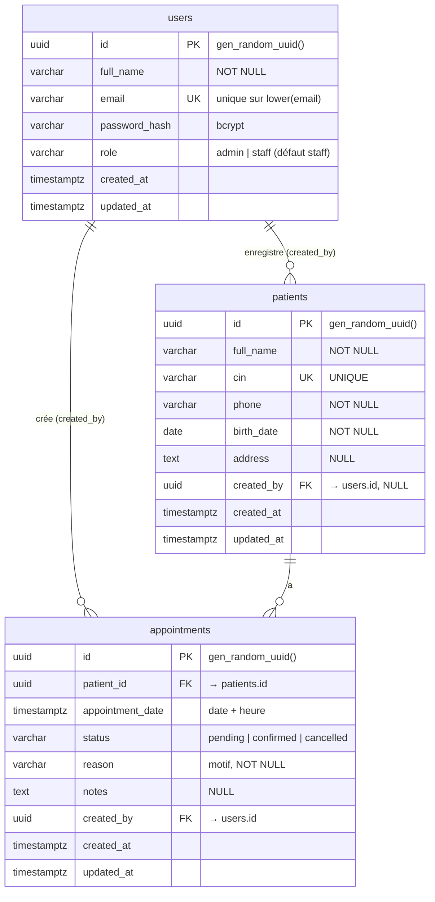

# ClinicFlow — Conception de la base de données

> SGBD : **PostgreSQL** (hébergé sur **Supabase** en tant que Postgres managé, ou conteneur `postgres:17` en local).
> Migrations SQL : [`apps/api/db/migrations`](../apps/api/db/migrations) · Seed : [`apps/api/db/seed.ts`](../apps/api/db/seed.ts)

## 1. Diagramme entité-relation (ERD)



## 2. Relations et justification

| Relation | Cardinalité | Règle FK | Justification |
|---|---|---|---|
| `patients` → `appointments` (`patient_id`) | **1-N** | `ON DELETE CASCADE` | Un patient peut avoir plusieurs rendez-vous ; un rendez-vous appartient à un seul patient. Un rendez-vous n'a aucun sens sans son patient : la suppression d'un patient (action **admin uniquement**) supprime ses rendez-vous, aucune ligne orpheline. |
| `users` → `appointments` (`created_by`) | **1-N** | `ON DELETE RESTRICT` | Un utilisateur crée plusieurs rendez-vous. Traçabilité : on interdit de supprimer un utilisateur qui a créé des rendez-vous (l'historique « qui a planifié quoi » est préservé). |
| `users` → `patients` (`created_by`) | **1-N** | `ON DELETE SET NULL` | Un utilisateur enregistre plusieurs patients. Le dossier patient doit survivre au départ du membre du personnel qui l'a créé ; on perd seulement l'auteur. |
| `patients` ↔ `users` | **N-N** (implicite) | via `appointments` | Un patient peut être pris en charge par plusieurs membres du personnel et inversement. La table `appointments` joue naturellement le rôle de table d'association (avec ses propres attributs : date, statut, motif) — aucune table de jointure supplémentaire n'est nécessaire. |
| 1-1 | — | — | Aucun besoin métier (pas de profil séparé du patient ou de l'utilisateur) ; un découpage 1-1 serait de la sur-ingénierie. |

## 3. Contraintes

| Contrainte | Où | Rôle |
|---|---|---|
| **UUID PK** | toutes les tables | `uuid DEFAULT gen_random_uuid()` (natif PG 13+) — identifiants non devinables, sûrs à exposer dans les URLs. |
| **`patients.cin` UNIQUE** | `patients_cin_uq` | Un CIN identifie une personne. Violation → API **409 Conflict**. |
| **email unique (insensible à la casse)** | `users_email_lower_uq` sur `lower(email)` | Empêche `Admin@x.ma` et `admin@x.ma` en double ; sert aussi la recherche au login. |
| **NOT NULL** | colonnes obligatoires | Les champs minimum du cahier des charges sont imposés par la base. |
| **Règle métier 30 min** | `appointments_no_confirmed_overlap_30min` (EXCLUDE GiST) | Voir § 5. |
| **`updated_at`** | triggers `*_set_updated_at` | Mis à jour automatiquement à chaque `UPDATE`. |

Les valeurs autorisées de `role` et `status` sont validées par l'API (schémas **Zod** partagés front/back).

## 4. Index (performance)

| Index | Type | Requête servie |
|---|---|---|
| `patients_full_name_trgm_idx` | GIN `pg_trgm` | `GET /api/patients?search=` → `full_name ILIKE '%…%'` (un B-tree ne sert pas un `LIKE` avec joker initial) |
| `patients_cin_trgm_idx` | GIN `pg_trgm` | recherche partielle par CIN |
| `patients_cin_uq` | B-tree (unique) | recherche exacte par CIN + unicité |
| `patients_created_at_idx` | B-tree | tri par défaut de la liste paginée (`ORDER BY created_at DESC LIMIT/OFFSET`) |
| `appointments_date_idx` | B-tree | filtre `?date=` (plage d'une journée) |
| `appointments_status_date_idx` | B-tree composite | filtre `?status=&date=` + compteurs du dashboard |
| `appointments_patient_date_idx` | B-tree composite | rendez-vous d'un patient (page détail) + index de la FK |
| `*_created_by_idx`, `users_email_lower_uq` | B-tree | index des FK (Postgres ne les crée pas automatiquement) / login |

## 5. Règle métier : 30 minutes entre deux rendez-vous confirmés

> *Un patient ne peut pas avoir 2 rendez-vous confirmés dans une fenêtre de 30 minutes.*

Interprétation : pour un même patient, deux rendez-vous au statut `confirmed` doivent être espacés d'**au moins 30 minutes** (`|t1 − t2| < 30 min` est refusé). Les rendez-vous `pending` / `cancelled` ne comptent pas.

Double protection :

1. **Base de données (garantie absolue)** — contrainte d'exclusion :
   ```sql
   EXCLUDE USING gist (
     patient_id WITH =,
     appointment_window(appointment_date) WITH &&   -- [t-15min, t+15min)
   ) WHERE (status = 'confirmed')
   ```
   Deux fenêtres `[t-15, t+15)` se chevauchent ⇔ `|t1 − t2| < 30 min`. La contrainte est vérifiée par Postgres lui-même : elle reste vraie même avec deux requêtes concurrentes (pas de *race condition* « check-then-insert »).
2. **Service API** — vérification préalable dans une transaction pour renvoyer un message clair en français ; si deux requêtes passent la vérification en même temps, l'erreur Postgres `23P01` (exclusion_violation) est traduite en **409 Conflict** avec le même message.

La règle s'applique à la **création** d'un rendez-vous confirmé et au **changement de statut** vers `confirmed`.

## 6. Sécurité (Supabase)

Sur Supabase, les tables du schéma `public` sont exposées par l'API REST auto-générée (clé `anon`). ClinicFlow n'utilise que sa propre API Express ; la migration `005_lockdown_data_api.sql` active donc la **RLS sans aucune policy** (refus total) et **révoque** tous les droits des rôles `anon`/`authenticated`. L'API se connecte avec le rôle propriétaire des tables et n'est pas affectée. Les mots de passe sont stockés hachés (**bcrypt**, coût 12).
